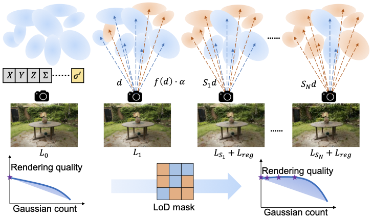

# CLoD-GS: Contiunous Level-of-Detail via 3D Gaussian Spaltting

Zhigang Cheng¹, Mingchao Sun², Yu Liu², Zengye Ge², Luyang Tang², Mu Xu²†, Yangyan Li²†, Peng Pan¹†

¹Tsinghua University, ²AMAP

*Corresponding authors: xumu.xm@alibaba-inc.com, yangyan.lee@gmail.com, pengpan@tsinghua.edu.cn*

## Introduction
This repository contains the official authors implementation associated with the paper "CLoD-GS: Continuous Level-of-Detail via 3D Gaussian Splatting", which can be found [here](https://arxiv.org/abs/2510.09997). 

Abstract: *Level of Detail (LoD) is a fundamental technique in real-time computer graphics for managing the rendering costs of complex scenes while preserving visual fidelity. Traditionally, LoD is implemented using discrete levels (DLoD), where multiple, distinct versions of a model are swapped out at different distances. This long-standing paradigm, however, suffers from two major drawbacks: it requires significant storage for multiple model copies and causes jarring visual ``popping" artifacts during transitions, degrading the user experience. We argue that the explicit, primitive-based nature of the emerging 3D Gaussian Splatting (3DGS) technique enables a more ideal paradigm: Continuous LoD (CLoD). A CLoD approach facilitates smooth, seamless quality scaling within a single, unified model, thereby circumventing the core problems of DLOD. To this end, we introduce CLoD-GS, a framework that integrates a continuous LoD mechanism directly into a 3DGS representation. Our method introduces a learnable, distance-dependent decay parameter for each Gaussian primitive, which dynamically adjusts its opacity based on viewpoint proximity. This allows for the progressive and smooth filtering of less significant primitives, effectively creating a continuous spectrum of detail within one model. To train this model to be robust across all distances, we introduce a virtual distance scaling mechanism and a novel coarse-to-fine training strategy with rendered point count regularization. Our approach not only eliminates the storage overhead and visual artifacts of discrete methods but also reduces the primitive count and memory footprint of the final model. Extensive experiments demonstrate that CLoD-GS achieves smooth, quality-scalable rendering from a single model, delivering high-fidelity results across a wide range of performance targets.*


## Features

- **Single Unified Model**  
  Eliminates the need to store multiple discrete model versions for different LoD levels, dramatically reducing storage overhead.

- **Smooth, Continuous Transitions**  
  Leverages a distance-adaptive opacity function to fade primitives out gracefully, providing seamless, "pop-free" quality scaling.

- **Dynamic Performance Control**  
  Allows for real-time adjustment of rendering complexity and performance by tuning a single scalar parameter (`virtual_scale` / `rvd_distance_scale`).

- **Compact Representation**  
  The training process results in a more compact final model with a reduced number of Gaussians and a smaller memory footprint compared to the baseline.

- **Easy Integration**  
  Built upon the original 3D Gaussian Splatting codebase with minimal and intuitive additions.

---

## How It Works


CLoD-GS introduces a learnable, continuous LoD mechanism through two primary components: a novel parameterization for each Gaussian primitive and a specialized training strategy.
### 1. Distance-Adaptive Opacity Attenuation

We introduce a single additional learnable parameter for each Gaussian primitive \(i\): the **distance decay factor** \(\sigma_{d,i}\). This parameter controls how rapidly the primitive's visibility decreases with distance.

At render time, we compute an attenuated opacity \(\alpha'_i\) based on the Gaussian’s distance to the camera \(d_i\) and a user-controllable virtual distance scale \(s_v\):

$$
\alpha'_i = \alpha_i \cdot \exp\left(-\frac{2 \cdot \mathrm{ReLU}(\sigma_{d,i})^2 + \epsilon}{(d_i \cdot s_v)^2}\right)
$$

This allows primitives to fade out smoothly as they move farther from the camera or as the virtual distance scale \(s_v\) is increased. A dynamic threshold, also scaled by \(s_v\), is then used to filter (cull) low-contribution Gaussians before they are sent to the rasterizer, enabling a continuous trade-off between performance and quality.

> *Note:* The exact functional form of the attenuation (numerator/denominator placement, constants) can be adapted; the formula above expresses the intended behavior: faster decay with larger learned \(\sigma_{d,i}\) and stronger culling as \(s_v\) increases.

### 2. Coarse-to-Fine Training with Point Count Regularization

To train a single model that is robust across the entire LoD spectrum, we employ a coarse-to-fine training strategy. During each iteration, we randomly sample a virtual distance scale factor \(s_v\) to simulate viewing the scene from various distances.

To explicitly encourage the model to use fewer primitives at higher virtual distances, we introduce a **point count regularization loss** \(L_{\text{reg}}\). This loss penalizes the model if the ratio of rendered primitives \(\eta_{\text{actual}}\) exceeds a dynamically calculated target ratio \(\eta_{\text{target}}\), which is inversely proportional to the virtual distance scale (i.e., fewer points allowed at larger scales):

$$
\eta_{\text{target}} \propto \frac{1}{s_v^{1.5}} \quad\text{(in practice: }\eta_{\text{target}} = s_v^{-1.5}\text{)}
$$

$$
L_{\text{reg}} = (s_v - 1.0)^2 \cdot \big(\mathrm{ReLU}(\eta_{\text{actual}} - \eta_{\text{target}})\big)^2
$$

This strategy trains the model to learn an efficient, view-dependent representation, enabling a single, robust model with controllable and continuous LoD capabilities.

---

## Installation

Our implementation is built upon the official 3D Gaussian Splatting repository:  
`https://github.com/graphdeco-inria/gaussian-splatting`

```bash
# Clone the repository and its submodules
git clone --recursive https://github.com/amap-cvlab/CLoD-GS.git
cd CLoD-GS

# Create and activate the conda environment
conda env create --file environment.yml
conda activate clod-gs
```

---

## Usage

The workflow follows the original 3D Gaussian Splatting pipeline, with additional arguments to control the CLoD functionality.

### Datasets

Prepare your dataset in the same format as the original 3DGS project (i.e., processed with COLMAP). Place your scene data in a directory, for example:

```
/path/to/your/dataset/tandt/truck
```

### Training

To train a CLoD-GS model, use `train.py` with the new arguments. Example:

```bash
CUDA_VISIBLE_DEVICES=0 python train.py -s /path/to/your/dataset/tandt/truck   -m /path/to/output/truck_clod_gs   --iterations 30000   --eval   # --- CLoD-GS Arguments ---
  --enable_opacity_decay_train \   # Enable training of the new distance decay parameter
  --enable_decay_opacity_render \  # Use decayed opacity in the rendering loss during training
  --enable_distance_culling \      # Enable dynamic culling of Gaussians during training
  --iter_start_culling 5000 \      # Start the CLoD mechanism after 5000 iterations
  --rvd_distance_scale 5.0 \       # Set the maximum virtual distance scale for training range [1.0, 5.0]
  --l_reg 1.0 \                    # Set the weight for the point count regularization loss
  --multi_scale_batch 2 \          # Use a batch size of 2 for multi-scale training
  --batch_mode "accumulated" \     # Accumulate gradients for the batch before updating
  --weight_scale                   # Use weights for different scales when computing loss
```

**Key new training arguments**

- `--enable_opacity_decay_train`  
  Enables the learning of the per-Gaussian distance decay parameter \(\sigma_{d,i}\).

- `--enable_decay_opacity_render`  
  During training, uses the dynamically attenuated opacity for rendering and loss calculation.

- `--enable_distance_culling`  
  Enables the dynamic filtering of low-opacity Gaussians during the training loop.

- `--iter_start_culling <int>`  
  The iteration at which to begin applying the CLoD training mechanisms (culling and regularization).

- `--rvd_distance_scale <float>`  
  The maximum virtual distance scale factor used during training. A random scale between 1.0 and this value will be sampled for each training batch.

- `--l_reg <float>`  
  The weight (\(\lambda_{\text{reg}}\)) for the point count regularization loss.

- `--multi_scale_batch <int>`  
  Number of different scales to process in a single batch for coarse-to-fine training.

- `--batch_mode <"per_scale"|"accumulated">`  
  If `accumulated`, gradients from all scales in a batch are accumulated before the optimizer step.

---

## Rendering at Different Levels of Detail

After training, render the scene at any desired level of detail by adjusting the `--rvd_distance_scale` argument in `render.py`. A higher value corresponds to a more aggressive LoD (fewer points, faster rendering).

```bash
# --- Render at full detail (equivalent to standard 3DGS) ---
CUDA_VISIBLE_DEVICES=0 python render.py -m /path/to/output/truck_clod_gs --iteration 30000   --rvd_distance_scale 1.0   --enable_distance_culling   --enable_opacity_decay_train  # Use this if the model was trained with it

# --- Render at a medium level of detail ---
CUDA_VISIBLE_DEVICES=0 python render.py -m /path/to/output/truck_clod_gs --iteration 30000   --rvd_distance_scale 5.0   --enable_distance_culling   --enable_opacity_decay_train

# --- Render at a very low level of detail ---
CUDA_VISIBLE_DEVICES=0 python render.py -m /path/to/output/truck_clod_gs --iteration 30000   --rvd_distance_scale 15.0   --enable_distance_culling   --enable_opacity_decay_train
```

You can also compare rendering with the learned attenuated opacity (`--enable_decay_opacity_render`) versus the original opacity at different scales for ablation studies.

---
  
## LICENSE

Please follow the LICENSE of [3D-GS](https://github.com/graphdeco-inria/gaussian-splatting).

## Acknowledgements

This work is built upon the official implementation of [**3D Gaussian Splatting for Real-Time Radiance Field Rendering**](https://repo-sam.inria.fr/fungraph/3d-gaussian-splatting/) by Inria. We are grateful to the authors for their groundbreaking work and for making their code publicly available.

---

## Citation

If you find our work useful for your research, please consider citing our paper:

```bibtex
@misc{cheng2025clodgscontinuouslevelofdetail3d,
      title={CLoD-GS: Continuous Level-of-Detail via 3D Gaussian Splatting}, 
      author={Zhigang Cheng and Mingchao Sun and Yu Liu and Zengye Ge and Luyang Tang and Mu Xu and Yangyan Li and Peng Pan},
      year={2025},
      eprint={2510.09997},
      archivePrefix={arXiv},
      primaryClass={cs.GR},
      url={https://arxiv.org/abs/2510.09997}, 
}
```

