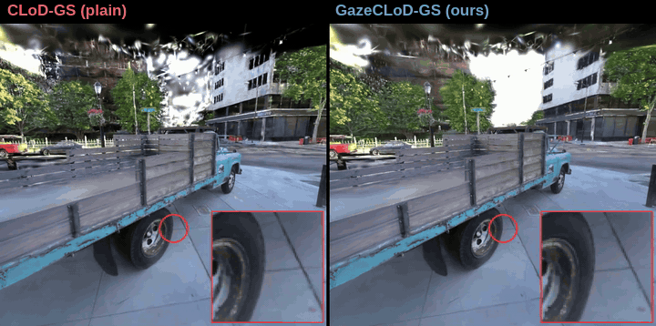

# GazeCLoD-GS: Gaze-Guided Continuous Level of Detail for Gaussian Splatting

Russell Mehta. Final project for CMSC740 Advanced Computer Graphics (Prof. Matthias Zwicker), University of Maryland, Fall 2026.

> This project is built on top of **[CLoD-GS](https://github.com/amap-cvlab/CLoD-GS)** by Cheng et al., which is itself built on **[3D Gaussian Splatting](https://github.com/graphdeco-inria/gaussian-splatting)** by Kerbl et al. The eye-tracking recordings come from **[EyeNavGS](https://symmru.github.io/EyeNavGS/)** by Ding et al. The training code, the renderer and the level-of-detail mechanism are theirs. What I added is explained below, and all of my code lives in [`gazeclod/`](gazeclod). Full credits are at the [bottom](#credits).



*A real person's recorded walk around the truck in VR, replayed with the same number of Gaussians on both sides. Left is plain CLoD-GS, right is GazeCLoD-GS. The red circle is where this person was actually looking, and the box in the corner zooms in 3x on that spot. This person's own eye data was never used to build the heat. It came from 12 other people.*

## The problem

A Gaussian splat stores a scene as millions of small, soft, see-through 3D blobs called Gaussians. To draw a frame, the GPU sorts the Gaussians in view and blends them together, so a frame costs more the more Gaussians it draws. VR makes this harder, because every frame has to be drawn twice (once per eye) and many times per second.

Level of detail (LOD) means drawing fewer Gaussians when you can't afford all of them. CLoD-GS does this smoothly with one dial for the whole scene. Think of Google Maps hiding small streets as you zoom out. It goes by how far away things are, and it has no idea which streets you care about. In a splat, that means a Gaussian of plain pavement is exactly as safe as a Gaussian of the truck's logo, even though people stare at the logo and barely glance at the pavement.

GazeCLoD-GS adds the missing piece. It uses recordings of real people in VR to learn which Gaussians they actually looked at, and keeps those Gaussians around longer.

## How CLoD-GS decides what to draw

CLoD-GS gives every Gaussian $i$ a learned fade rate $\sigma_i$. At render time, one dial $s$ (the *virtual distance scale*) pretends the camera is $s$ times farther away than it really is, and each Gaussian's opacity $\alpha_i$ fades with that pretend distance:

$$
\text{decay}_i = \exp\left(-\frac{(d_i\, s)^2}{2\,\mathrm{ReLU}(\sigma_i)^2 + 10^{-6}}\right), \qquad \alpha_i' = \alpha_i \cdot \text{decay}_i
$$

Here $d_i$ is the Gaussian's distance to the camera divided by the size of the scene (the average distance of all Gaussians from their center). This is the formula as written in their code. A Gaussian is drawn only if its faded opacity clears a bar that also rises with $s$:

$$
\text{keep } i \iff \alpha_i' > 0.005\, s
$$

If fewer than 5,000 Gaussians pass, CLoD-GS keeps the 5,000 with the highest faded opacity. Turning $s$ up makes everything fade faster and raises the bar at the same time, so fewer Gaussians get drawn. At $s = 1$ you get full detail.

## What GazeCLoD-GS changes

Instead of one $s$ for the whole scene, every Gaussian gets its own:

$$
s_i = \max\left(1,\ s_{\text{base}}\, e^{-k\, h_i}\right)
$$

- $h_i$ is the Gaussian's **heat**, a number from 0 to 1 for how much people looked at it ([next section](#where-the-heat-comes-from)).
- $k$ is how strongly heat counts. With $k = 0$ every Gaussian gets the same $s$, which is plain CLoD-GS. The main results use $k = 4$.
- $s_{\text{base}}$ is the dial for everything else. It is chosen for every frame so GazeCLoD-GS draws the same number of Gaussians as plain CLoD-GS ([Fair comparison](#fair-comparison)).
- The $\max(1, \cdot)$ makes sure no Gaussian is ever drawn with more detail than the full-detail render.

A Gaussian nobody looked at ($h_i = 0$) gets $s_i = s_{\text{base}}$ and fades first. A Gaussian everyone looked at ($h_i = 1$) gets $s_{\text{base}}$ divided by $e^4 \approx 55$, so it stays sharp much longer.

The only change to CLoD-GS's own code is 6 lines in `scene/gaussian_model.py` (`get_lod_filter_mask`, marked `GazeCLoD-GS`) so the keep rule accepts one $s_i$ per Gaussian instead of a single number.

## Where the heat comes from

### The eye-tracking data

[EyeNavGS](https://symmru.github.io/EyeNavGS/) recorded people walking around these same scenes in VR with Meta Quest Pro headsets, which can track where your eyes point. For every frame it saves the head pose (position and rotation) and the gaze direction. I use the 24 people recorded at NTHU for each scene.

The recordings use VR's axes (y up, z backward), while the splat uses y down and z forward. Reading the EyeNavGS viewer's source code showed that the fix is a 180° flip around the x axis, $M = \mathrm{diag}(1, -1, -1)$:

$$
C = M\,p, \qquad R = M\,R(q)\,M, \qquad \mathbf{g} = M\,R(q_{\text{gaze}})\,(0, 0, -1)^\top
$$

$p$ and $q$ are the recorded eye position and rotation (a quaternion). $C$ and $R$ are the camera's position and rotation in the splat (the second $M$ flips the camera's own axes the same way), and $\mathbf{g}$ is the gaze direction. To check it, `check_alignment.py` renders people's recorded views with their gaze drawn on top. The views come out upright and the gaze lands on things like the truck's logo, signs and wheels.

### Picking the glances

I sample each person's gaze 10 times per second. While the eye jumps from one target to the next (a saccade) it barely sees anything, so those moments are dropped. A sample counts as a jump if the gaze turns faster than 100° per second:

$$
\frac{\angle(\mathbf{g}_t,\ \mathbf{g}_{t - \Delta t})}{\Delta t} > 100^\circ/\text{s}
$$

That leaves about 14,000 glances per scene.

### Scoring one glance

For each glance I render a tiny 48×48 image looking straight down the gaze direction. Only the center of your vision (the fovea, a few degrees wide) sees sharply, so each pixel is weighted by how close it is to that center:

$$
w(p) = \frac{e^{-\theta_p^2 / 2\sigma^2}}{\sum_{p'} e^{-\theta_{p'}^2 / 2\sigma^2}}, \qquad \sigma = 2.5^\circ
$$

$\theta_p$ is the angle between pixel $p$ and the gaze direction, and the tiny camera covers $\pm 3\sigma$.

A splat image is a front-to-back blend. With the Gaussians sorted from nearest to farthest, pixel $p$ gets the color

$$
C(p) = \sum_i c_i\, \alpha_i(p)\, T_i(p), \qquad T_i(p) = \prod_{j < i} \big(1 - \alpha_j(p)\big)
$$

$c_i$ is Gaussian $i$'s color, $\alpha_i(p)$ is how opaque it is at that pixel, and $T_i(p)$ is how much light still gets through the Gaussians in front of it. So $\alpha_i(p)\,T_i(p)$ is exactly Gaussian $i$'s share of that pixel. A glance gives each Gaussian credit for its share of the weighted center of vision:

$$
\text{heat}_i = \sum_p w(p)\, \alpha_i(p)\, T_i(p)
$$

Working this out one Gaussian at a time would be far too slow. The shortcut is that the weighted image is a plain weighted sum of the colors $c_i$, so its derivative with respect to $c_i$ is exactly that share:

$$
\frac{\partial}{\partial c_i} \sum_p w(p)\, C(p) = \sum_p w(p)\, \alpha_i(p)\, T_i(p)
$$

The renderer can already compute derivatives like this for training, so one backward pass (the gradient step PyTorch runs during training) gives the heat of all ~2 million Gaussians at once.

### Adding it all up

Every person counts equally. A person's heat is the average over their glances, and the crowd's heat $H_i$ is the sum over people. I build two versions: one aimed along each person's **gaze**, and one aimed along their **head**'s forward direction (which any headset knows, even without eye tracking). Then I add the two together. Gaze alone does best where people look, head direction alone does best over the whole frame, and the sum stays close to the best of each.

Last, the heat is squeezed into $[0, 1]$:

$$
h_i = \min\left(1,\ \frac{H_i}{H_{99}}\right)^{\gamma}, \qquad \gamma = 0.5
$$

$H_{99}$ is the 99th percentile of heat among the Gaussians that got any. Dividing by that instead of the maximum stops a few extreme Gaussians from flattening everything else, and the square root ($\gamma = 0.5$) lifts the lukewarm Gaussians a bit.

### What I tried first

My first heat was a simpler "stamp" score. Every glance stamps each Gaussian whose *center* sits near the gaze direction and isn't hidden behind a surface:

$$
H_i = \sum_{\text{glances}} e^{-\theta_i^2 / 2\sigma^2}\, v_i
$$

$\theta_i$ is the angle between the gaze and the direction to Gaussian $i$'s center, and $v_i = 1$ when the center is no more than 10% deeper than the visible surface at that spot (averaged and summed over people the same way). Its heatmaps looked more convincing, with red on the truck and gray on the pavement. For LOD it was worse. At all but the lightest budget it gained only +0.2 to +1.5 dB where people look (the blending-share score gained +4.7 to +6.8 dB, both at $k = 2$), and it lost up to 5.4 dB over the whole frame. The blending-share score credits the Gaussians that actually make up what people see, including big ones whose centers sit off to the side. It turned out that the heatmap that looks best as a picture was the worse one for LOD.

## Fair comparison

Both methods have to draw the same number of Gaussians, or one could look better just by drawing more. For each test frame:

1. Run plain CLoD-GS at dial $s$ and count the Gaussians it keeps **in view**: center in front of the camera (depth above 0.2) and inside the field of view plus a 10% margin.
2. Find the smallest $s_{\text{base}}$ where GazeCLoD-GS keeps no more Gaussians in view than that:

$$
s_{\text{base}}^{*} = \min \left\{ s_{\text{base}} \;:\; N_{\text{view}}(s_{\text{base}}) \le N_{\text{view}}^{\text{CLoD}}(s) \right\}
$$

Raising $s_{\text{base}}$ can only remove Gaussians, since every $s_i$ goes up and every keep test gets harder. So a binary search works: try a value, count, cut the range in half, repeat.

I count only Gaussians in view because the renderer throws away everything outside the view almost for free. My first version matched the total count instead, and GazeCLoD-GS ended up spending its budget on hot Gaussians behind the camera, sometimes drawing 36% fewer Gaussians in view than CLoD-GS. With matching in view, both sides draw the same number (within 0.3%) and take the same render time.

## How I measured quality

- **Split:** heat from 12 NTHU viewers (odd user numbers), tested on the other 12 (even), then swapped. Nobody is ever tested against heat that includes their own eyes.
- **Test frames:** one moment every 2 seconds of each test viewer's recording (saccades skipped), using their real head pose and gaze. That gives 721 frames per scene, rendered at 512×512 with a 90° field of view, at five budgets $s \in \{2, 4, 8, 12, 16\}$.
- **Reference:** the same model at full detail ($s = 1$). VR views have no real photo to compare against.
- **Regions:** the whole frame, and "where they look", meaning pixels within 5° of that viewer's actual gaze. Empty pixels (opacity below 0.5 in the full-detail render, mostly missing sky) are skipped.
- **Scores:** PSNR, plus SSIM and LPIPS. With pixel values from 0 to 1,

$$
\text{PSNR} = 10 \log_{10} \frac{1}{\text{MSE}}
$$

so +3 dB means about half the error and +10 dB means a tenth of it.

## Results

Median PSNR gain of GazeCLoD-GS ($k = 4$, gaze + head heat) over plain CLoD-GS with the same number of Gaussians in view:

| CLoD-GS budget $s$ | Truck, where they look | Truck, whole frame | Playroom, where they look | Playroom, whole frame |
|---|---|---|---|---|
| 2 | +8.0 dB | +6.9 dB | +8.1 dB | +6.1 dB |
| 4 | +6.5 dB | +4.3 dB | +4.2 dB | +3.4 dB |
| 8 | +8.2 dB | +3.4 dB | +3.9 dB | +3.0 dB |
| 12 | +8.5 dB | +1.6 dB | +3.8 dB | +2.2 dB |
| 16 | +6.7 dB | +2.0 dB | +3.2 dB | +0.8 dB |

Where people look, the gain is +3.2 to +8.5 dB, and the whole frame gets better too (+0.8 to +6.9 dB), all at the same cost. GazeCLoD-GS wins where people look in 91 to 99% of frames on truck and 85 to 98% on playroom, and all 24 test viewers have a positive median gain at every budget in both scenes.


In the chart, "gaze only" and "head direction only" are the two halves of the heat used on their own. The shuffled control gives the same heat values to random Gaussians. It does no better than plain CLoD-GS (−2.8 to +0.6 dB where people look), which shows the gain comes from the recordings themselves.

Flipped around, GazeCLoD-GS needs 13 to 35% fewer Gaussians on truck and 23 to 32% fewer on playroom to match plain CLoD-GS's quality where people look. That makes frames 5 to 11% faster at 512×512. The time saving is smaller than the Gaussian saving because part of every frame's cost (like running the keep test over all Gaussians) doesn't shrink.

On truck, heat from 6 people already gives about 90% of the gain from all 12, and even a single person helps a little (+1.4 to +2.3 dB).

Two reference rows show how far this could go. A "live" version builds heat from only the test viewer's current glance (what an eye tracker would give in the moment, scored with the stamp formula) and gains +1.2 to +2.8 dB on truck. An "oracle" knows exactly which Gaussians make up the pixels the viewer is looking at in that very frame. It gains +16 to +23 dB on truck, but it needs the full-detail render of that frame, which is exactly what LOD is trying to avoid. So a better heat still has a lot of room to grow.

The cost is one extra number per Gaussian: +9.4 MB on truck's 594 MB model (+1.6%) as a 32-bit float, or +0.4% as a single byte. Building a heat file takes about 3 to 4 minutes per scene on a laptop RTX 4070. Working out every $s_i$ is one quick formula per Gaussian, so render time is unchanged at the same budget.

There is one weak spot. At the tightest playroom budget ($s = 16$, only 16% of Gaussians kept) the median frame still improves, but a minority of frames lose a lot of the room outside the hot areas. Those frames drag the whole-frame PSNR averaged over all frames down from 28.3 to 24.6 dB. A gentler $k = 2$ avoids this.


*Truck at $s = 16$. I picked these frames because their gain sits at the median. Left: full detail. Middle: plain CLoD-GS. Right: GazeCLoD-GS with the same number of Gaussians in view.*

## What's in this repo

Everything I wrote lives in [`gazeclod/`](gazeclod). The rest is the CLoD-GS code base (which includes the 3DGS code) as of [CLoD-GS commit 1090dfb](https://github.com/amap-cvlab/CLoD-GS/commit/1090dfb), plus the 6-line change to `scene/gaussian_model.py` described above.

| File | What it does |
|---|---|
| `gazeclod/gaze_io.py` | Reads EyeNavGS recordings and moves head and gaze poses into the splat's axes |
| `gazeclod/cam_utils.py` | Cameras for any pose, and gaze-to-pixel projection |
| `gazeclod/common.py` | Model loading and render helpers |
| `gazeclod/check_alignment.py` | Renders a viewer's recorded views with their gaze drawn on top |
| `gazeclod/heatmap.py` | Turns the recordings into per-Gaussian heat (blending-share or stamp score, aimed by gaze or head) |
| `gazeclod/show_heat.py` | Colors the splat by heat |
| `gazeclod/lod_policy.py` | The per-Gaussian $s_i$, budget matching, the odd/even split and the shuffled control |
| `gazeclod/lod_demo.py` | Small demo at a single budget |
| `gazeclod/eval_gaze_lod.py` | The main experiment: every method, budget and score written to a CSV, plus a summary |
| `gazeclod/make_examples.py`, `make_video.py` | Example frames figure and the side-by-side video |
| `gazeclod/viewer.py`, `run_viewer.bat`, `run_viewer.sh` | Live interactive viewer |

## Setup

You need an NVIDIA GPU, because the renderer is written in CUDA (NVIDIA's GPU language), so Macs can't run it. I tested on Windows with a laptop RTX 4070 (8 GB), Visual Studio 2022 Build Tools 17.14, CUDA 12.8, Python 3.10 and PyTorch 2.7.1. CLoD-GS's `environment.yml` pins PyTorch 2.2.0, which has no CUDA 12.8 build, so I set up the environment by hand:

```bash
git clone --recursive https://github.com/RRfyOfficial/GazeCLoD-GS.git
cd GazeCLoD-GS
conda create -n clodgs python=3.10 -y
conda activate clodgs
pip install torch==2.7.1 torchvision==0.22.1 --index-url https://download.pytorch.org/whl/cu128
pip install plyfile tqdm opencv-python joblib
```

Then build the three CUDA extensions. On Windows, do this in the "x64 Native Tools Command Prompt for VS 2022" after `set DISTUTILS_USE_SDK=1` and `set TORCH_CUDA_ARCH_LIST=8.9` (8.9 is the RTX 40 series, so change it for your GPU):

```bash
pip install --no-build-isolation submodules/simple-knn
pip install --no-build-isolation submodules/fused-ssim
pip install --no-build-isolation submodules/diff-gaussian-rasterization
```

## Data

- **Scenes:** download [`tandt_db.zip`](https://repo-sam.inria.fr/fungraph/3d-gaussian-splatting/datasets/input/tandt_db.zip) and unzip it into `data/`. Truck ends up in `data/tandt/truck` and playroom in `data/db/playroom`.
- **Eye tracking:** clone the EyeNavGS [NTHU dataset](https://github.com/sawalee0811/EyeNavGS_NTHU_Dataset) into `data/eyenavgs/nthu` and the [Rutgers dataset](https://github.com/symmru/EyeNavGS_Rutgers_Dataset) into `data/eyenavgs/rutgers`. The [EyeNavGS software](https://github.com/symmru/EyeNavGS_Software) (`data/eyenavgs/software`) is only needed if you want to see where the coordinate flip came from.

## Running it

Run everything from the repo root with the `clodgs` environment active. The examples use truck. For playroom, swap `truck` for `playroom` and `data/tandt/truck` for `data/db/playroom`.

**1. Train CLoD-GS** (about 1 hour 40 minutes per scene on my laptop). The CLoD flags are explained in the [CLoD-GS README](https://github.com/amap-cvlab/CLoD-GS#training).

```bash
python train.py -s data/tandt/truck -m output/truck_clod --eval --data_device cpu --disable_viewer --iterations 30000 --enable_opacity_decay_train --enable_decay_opacity_render --enable_distance_culling --iter_start_culling 5000 --rvd_distance_scale 5.0 --l_reg 1.0 --multi_scale_batch 2 --batch_mode accumulated --weight_scale
```

**2. Check that the gaze lines up with the splat** (optional). Writes `output/truck_clod/gaze_check/align_nthu_user10.png`.

```bash
python gazeclod/check_alignment.py -m output/truck_clod --scene truck --site nthu --user user10
```

**3. Build the heat**, once aimed by gaze and once by head (about 3 to 4 minutes each). The files go to `output/truck_clod/gaze_heat/`. Leaving out `--mode mass` gives the stamp score instead.

```bash
python gazeclod/heatmap.py -m output/truck_clod --scene truck --site nthu --mode mass
python gazeclod/heatmap.py -m output/truck_clod --scene truck --site nthu --mode mass --aim head
```

**4. Run the experiment.** The `+` adds the two heat files together. Adding `--no-live --no-oracle` skips the two reference rows and runs faster.

```bash
python gazeclod/eval_gaze_lod.py -m output/truck_clod --scene truck --heat output/truck_clod/gaze_heat/heat_nthu_truck_mass_sig2.5.npz+output/truck_clod/gaze_heat/heat_nthu_truck_mass_head_sig2.5.npz --main-name combo --k-sweep 4 --tag main
python gazeclod/eval_gaze_lod.py -m output/truck_clod --summary output/truck_clod/gaze_lod/results_main.csv
```

**5. Make the figures and the video**, using the same `--heat` value as step 4 in place of `<heat>`.

```bash
python gazeclod/make_examples.py -m output/truck_clod --scene truck --heat <heat> --frames even:user12:3538 odd:user19:2894
python gazeclod/make_video.py -m output/truck_clod --scene truck --heat <heat> --user user12
```

**6. Try the live viewer.** On Windows, double-click `gazeclod/run_viewer.bat`. Or:

```bash
python gazeclod/viewer.py                    # starts in truck
python gazeclod/viewer.py --scene playroom   # starts in playroom
```

The left half is plain CLoD-GS and the right half is GazeCLoD-GS, always with the same number of Gaussians. Your mouse plays the eye tracker. Hold W A S D to walk, left-drag to turn, press `[` and `]` for fewer or more Gaussians, 1 to 4 to change the right half, Z for a zoom box, R to replay a recorded viewer, T to switch scenes and ESC to quit.

## Credits

- **CLoD-GS** by Zhigang Cheng, Mingchao Sun, Yu Liu, Zengye Ge, Luyang Tang, Mu Xu, Yangyan Li and Peng Pan ([code](https://github.com/amap-cvlab/CLoD-GS), [paper](https://arxiv.org/abs/2510.09997)). This repo started as a copy of their code. The training, the rendering and the continuous level-of-detail mechanism are theirs.
- **3D Gaussian Splatting** by Bernhard Kerbl, Georgios Kopanas, Thomas Leimkühler and George Drettakis, Inria and MPII ([code](https://github.com/graphdeco-inria/gaussian-splatting), [project page](https://repo-sam.inria.fr/fungraph/3d-gaussian-splatting/)). The base of CLoD-GS, including the CUDA renderer.
- **EyeNavGS** by Zihao Ding, Cheng-Tse Lee, Mufeng Zhu, Tao Guan, Yuan-Chun Sun, Cheng-Hsin Hsu and Yao Liu ([project page](https://symmru.github.io/EyeNavGS/), [paper](https://arxiv.org/abs/2506.02380)). The head and eye-tracking recordings, plus the record-and-replay viewer whose source code showed how to line their poses up with the splat.
- **Scenes:** Truck from Tanks and Temples and Playroom from Deep Blending, as packaged by the 3DGS authors.
- I built this with help from Claude (Anthropic) as a coding assistant. The details are in the AI usage statement in my project report.

## License

This repo keeps the [Gaussian-Splatting License](LICENSE.md) that covers the 3DGS and CLoD-GS code it is built on (non-commercial research and evaluation use). The EyeNavGS recordings and the scene datasets have their own terms, so check those before using them.

## Citation

If this is useful to you, please cite the work it builds on:

```bibtex
@misc{cheng2025clodgs,
  title         = {CLoD-GS: Continuous Level-of-Detail via 3D Gaussian Splatting},
  author        = {Zhigang Cheng and Mingchao Sun and Yu Liu and Zengye Ge and Luyang Tang and Mu Xu and Yangyan Li and Peng Pan},
  year          = {2025},
  eprint        = {2510.09997},
  archivePrefix = {arXiv},
  primaryClass  = {cs.GR},
  url           = {https://arxiv.org/abs/2510.09997}
}

@article{kerbl3Dgaussians,
  author  = {Kerbl, Bernhard and Kopanas, Georgios and Leimk{\"u}hler, Thomas and Drettakis, George},
  title   = {3D Gaussian Splatting for Real-Time Radiance Field Rendering},
  journal = {ACM Transactions on Graphics},
  number  = {4},
  volume  = {42},
  month   = {July},
  year    = {2023},
  url     = {https://repo-sam.inria.fr/fungraph/3d-gaussian-splatting/}
}

@inproceedings{ding2025eyenavgs,
  title     = {EyeNavGS: A 6-DoF Navigation Dataset and Record-n-Replay Software for Real-World 3DGS Scenes in VR},
  author    = {Zihao Ding and Cheng-Tse Lee and Mufeng Zhu and Tao Guan and Yuan-Chun Sun and Cheng-Hsin Hsu and Yao Liu},
  booktitle = {Proceedings of the 33rd ACM International Conference on Multimedia},
  year      = {2025}
}
```
