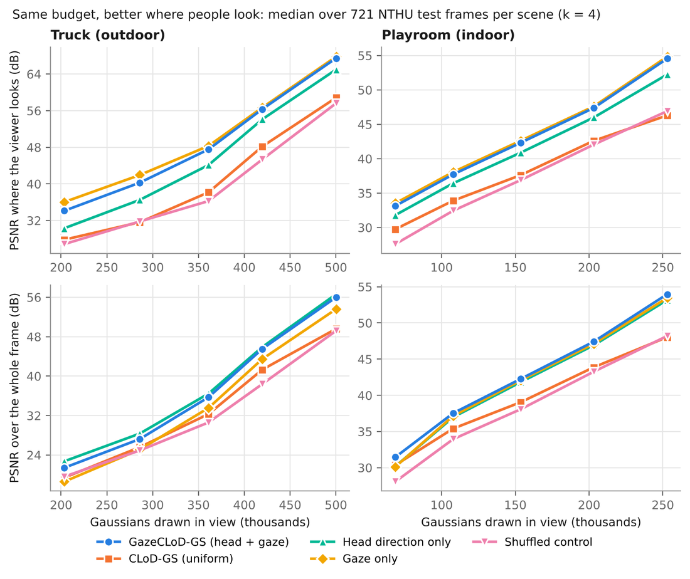
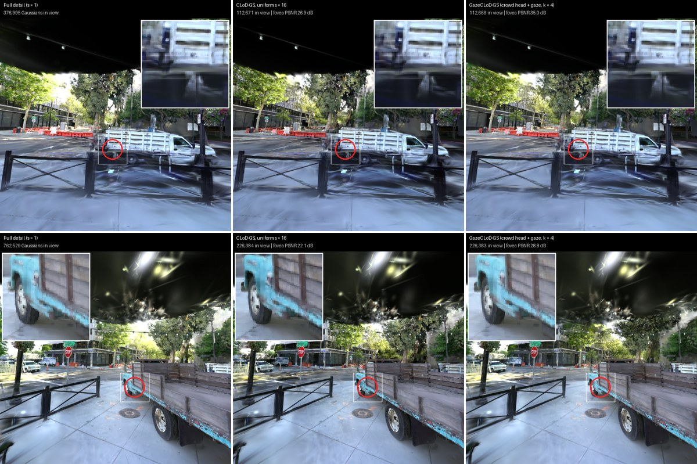

# GazeCLoD-GS: Gaze-Guided Continuous Level of Detail for Gaussian Splatting

Russell Mehta. Final project for CMSC740 Advanced Computer Graphics (Prof. Matthias Zwicker), University of Maryland, Fall 2026.

> **Built on [CLoD-GS](https://github.com/amap-cvlab/CLoD-GS)** by Cheng et al., which itself builds on **[3D Gaussian Splatting](https://github.com/graphdeco-inria/gaussian-splatting)** by Kerbl et al. Eye-tracking data comes from **[EyeNavGS](https://symmru.github.io/EyeNavGS/)** by Ding et al. All credit for those parts goes to their authors (see [Credits](#credits)).


*A real VR viewer's recorded walk around the truck, replayed at the same number of Gaussians on both sides. Left: plain CLoD-GS. Right: GazeCLoD-GS. Red circle: where this viewer actually looked. Corner box: 3x zoom of that spot. The viewer's own gaze was never used to build the heat. It comes from 12 other people.*

## The idea

When a GPU can't draw every blob in a Gaussian splat, it has to drop some. [CLoD-GS](https://github.com/amap-cvlab/CLoD-GS) does this smoothly with one global knob, the virtual distance scale $s$. Turning $s$ up makes every Gaussian fade as if the camera were farther away, and faded Gaussians get culled. The knob treats every Gaussian the same, so a blob of plain pavement is as safe as a blob of the truck's logo.

GazeCLoD-GS gives every Gaussian its own knob, set by **where real people looked** in VR:

$$
s_i = \max\left(1,\ s_{\text{base}}\, e^{-k\, h_i}\right)
$$

- $h_i \in [0, 1]$ is Gaussian $i$'s **crowd heat**: how much it filled the center of people's vision in the [EyeNavGS](https://symmru.github.io/EyeNavGS/) recordings (24 NTHU viewers per scene, wearing eye-tracking Meta Quest Pro headsets).
- Hot Gaussians get a smaller $s_i$ (more detail). Cold ones fade first. $k$ sets how strongly heat counts ($k = 0$ is plain CLoD-GS).
- $s_{\text{base}}$ is found per frame by bisection so that **both methods draw the same number of Gaussians in view**. Same budget, same render time. The only question is which picture looks better.

**How the heat is built.** Each recorded glance (10 per second, saccades removed) renders a tiny camera aimed along the gaze ray. A Gaussian earns heat equal to its blending weight $T_i \alpha_i$ in that tiny image, weighted by a 2.5° foveal Gaussian. Because the image is linear in per-Gaussian colors, one backward pass through the rasterizer gives this number for every Gaussian at once. The final heat is the sum of a gaze-aimed version and a head-aimed version (the direction the headset pointed), which turned out to be the best of both.

## Results

Evaluated on two scenes, truck (outdoor) and playroom (indoor). Heat from 12 NTHU viewers, tested on the other 12 viewers' recorded head poses and gaze, then swapped (721 test frames per scene). Reference: the same model at full detail. "Where they look" = pixels within 5° of the test viewer's own gaze.

Median PSNR gain of GazeCLoD-GS ($k = 4$) over plain CLoD-GS at the same number of Gaussians in view:

| CLoD-GS budget $s$ | Truck, where they look | Truck, whole frame | Playroom, where they look | Playroom, whole frame |
|---|---|---|---|---|
| 2 | +8.0 dB | +6.9 dB | +8.1 dB | +6.1 dB |
| 4 | +6.5 dB | +4.3 dB | +4.2 dB | +3.4 dB |
| 8 | +8.2 dB | +3.4 dB | +3.9 dB | +3.0 dB |
| 12 | +8.5 dB | +1.6 dB | +3.8 dB | +2.2 dB |
| 16 | +6.7 dB | +2.0 dB | +3.2 dB | +0.8 dB |



- **The gaze data is what helps.** A shuffled control (the same heat values given to random Gaussians) gains nothing real where people look (-2.8 to +0.6 dB), so the win comes from the recordings, not from just being non-uniform.
- **Consistent.** All 24 test viewers have a positive median gain where they look, at every budget, in both scenes.
- **A handful of people is enough.** On truck, heat from 6 people gives about 90% of the gain from 12.
- **Or spend less.** To match plain CLoD-GS's quality where people look, GazeCLoD-GS needs 13 to 35% fewer Gaussians on truck and 23 to 32% fewer on playroom.
- **Cost:** one extra number per Gaussian (+1.6% storage as float32, +0.4% as uint8), about 3 to 4 minutes of preprocessing per heat file, and no extra render time.
- **Honest caveat:** at the tightest playroom budget (16% of Gaussians kept) a minority of frames lose a lot of the room outside the hot areas. A gentler $k = 2$ avoids this.



*Truck at $s = 16$. These frames sit at the median gain, they were not cherry-picked. Left: full detail. Middle: plain CLoD-GS. Right: GazeCLoD-GS with the same number of Gaussians in view.*

## What's in this repo

Everything new lives in [`gazeclod/`](gazeclod). The rest is the CLoD-GS code base (which includes the 3DGS code) as of [CLoD-GS commit 1090dfb](https://github.com/amap-cvlab/CLoD-GS/commit/1090dfb), with one small change:

- `scene/gaussian_model.py`, `get_lod_filter_mask`: 6 lines (marked `GazeCLoD-GS`) so the culling threshold works with a per-Gaussian scale instead of a single number. Same behavior as before for a single number.

| File | What it does |
|---|---|
| `gazeclod/gaze_io.py` | Reads EyeNavGS CSVs and maps VR head and gaze poses into the splat's coordinate frame |
| `gazeclod/cam_utils.py` | Cameras for any pose, gaze-to-pixel projection |
| `gazeclod/common.py` | Model loading and render helpers |
| `gazeclod/check_alignment.py` | Renders a viewer's recorded views with gaze circles (sanity check for the mapping) |
| `gazeclod/heatmap.py` | Crowd gaze to per-Gaussian heat (blame and stamp scoring, gaze or head aim) |
| `gazeclod/show_heat.py` | Colors the splat by heat |
| `gazeclod/lod_policy.py` | The per-Gaussian knob, budget matching, team split, shuffled control |
| `gazeclod/lod_demo.py` | Small one-budget demo |
| `gazeclod/eval_gaze_lod.py` | Main experiment: all methods, budgets and metrics (PSNR, SSIM, LPIPS) to a CSV, plus a summary |
| `gazeclod/make_examples.py`, `make_video.py` | Example frames figure and side-by-side video |
| `gazeclod/viewer.py`, `run_viewer.bat`, `run_viewer.sh` | Live interactive viewer |

## Setup

Needs an NVIDIA GPU (the splat rasterizer is CUDA code, so macOS is not supported). Tested on native Windows with an RTX 4070 laptop GPU (8 GB), Visual Studio 2022 Build Tools 17.14, CUDA 12.8, Python 3.10 and PyTorch 2.7.1. The `environment.yml` from CLoD-GS pins PyTorch 2.2.0, which has no CUDA 12.8 build, so we skip it.

```bash
git clone --recursive https://github.com/RRfyOfficial/GazeCLoD-GS.git
cd GazeCLoD-GS
conda create -n clodgs python=3.10 -y
conda activate clodgs
pip install torch==2.7.1 torchvision==0.22.1 --index-url https://download.pytorch.org/whl/cu128
pip install plyfile tqdm opencv-python joblib
```

Then build the CUDA extensions. On Windows, do this in the "x64 Native Tools Command Prompt for VS 2022" with `set DISTUTILS_USE_SDK=1` and `set TORCH_CUDA_ARCH_LIST=8.9` (8.9 is the RTX 40 series, change it for your GPU):

```bash
pip install --no-build-isolation submodules/simple-knn
pip install --no-build-isolation submodules/fused-ssim
pip install --no-build-isolation submodules/diff-gaussian-rasterization
```

## Data

- **Scenes:** download [`tandt_db.zip`](https://repo-sam.inria.fr/fungraph/3d-gaussian-splatting/datasets/input/tandt_db.zip) and extract it into `data/`. Truck is `data/tandt/truck`, playroom is `data/db/playroom`.
- **Eye tracking:** clone the EyeNavGS [NTHU dataset](https://github.com/sawalee0811/EyeNavGS_NTHU_Dataset) to `data/eyenavgs/nthu` and the [Rutgers dataset](https://github.com/symmru/EyeNavGS_Rutgers_Dataset) to `data/eyenavgs/rutgers`. The [EyeNavGS software](https://github.com/symmru/EyeNavGS_Software) (`data/eyenavgs/software`) is only needed if you want to read how the coordinate mapping was derived.

## Running it

Run everything from the repo root with the `clodgs` environment active. Examples use truck. For playroom, swap `truck` for `playroom` and `data/tandt/truck` for `data/db/playroom`.

**1. Train CLoD-GS** (about 1 h 40 min per scene on the laptop GPU). The CLoD flags are explained in the [CLoD-GS README](https://github.com/amap-cvlab/CLoD-GS#training).

```bash
python train.py -s data/tandt/truck -m output/truck_clod --eval --data_device cpu --disable_viewer --iterations 30000 --enable_opacity_decay_train --enable_decay_opacity_render --enable_distance_culling --iter_start_culling 5000 --rvd_distance_scale 5.0 --l_reg 1.0 --multi_scale_batch 2 --batch_mode accumulated --weight_scale
```

**2. Check that the gaze lines up with the splat** (optional). Writes `output/truck_clod/gaze_check/align_nthu_user10.png`.

```bash
python gazeclod/check_alignment.py -m output/truck_clod --scene truck --site nthu --user user10
```

**3. Build the crowd heat** (gaze-aimed and head-aimed, about 3 to 4 min each). Files go to `output/truck_clod/gaze_heat/`.

```bash
python gazeclod/heatmap.py -m output/truck_clod --scene truck --site nthu --mode mass
python gazeclod/heatmap.py -m output/truck_clod --scene truck --site nthu --mode mass --aim head
```

**4. Run the experiment.** The `+` sums the two heat files. Add `--no-live --no-oracle` to skip the two upper-bound rows and run faster.

```bash
python gazeclod/eval_gaze_lod.py -m output/truck_clod --scene truck --heat output/truck_clod/gaze_heat/heat_nthu_truck_mass_sig2.5.npz+output/truck_clod/gaze_heat/heat_nthu_truck_mass_head_sig2.5.npz --main-name combo --k-sweep 4 --tag main
python gazeclod/eval_gaze_lod.py -m output/truck_clod --summary output/truck_clod/gaze_lod/results_main.csv
```

**5. Figures and video.** Same heat argument as step 4.

```bash
python gazeclod/make_examples.py -m output/truck_clod --scene truck --heat <heat> --frames even:user12:3538 odd:user19:2894
python gazeclod/make_video.py -m output/truck_clod --scene truck --heat <heat> --user user12
```

**6. Live viewer.** On Windows, double-click `gazeclod/run_viewer.bat`. Or:

```bash
python gazeclod/viewer.py                    # starts in truck
python gazeclod/viewer.py --scene playroom   # starts in playroom
```

Left half is plain CLoD-GS, right half is GazeCLoD-GS, always at the same number of Gaussians. Your mouse plays the eye tracker. Hold W A S D to walk, left-drag to turn, `[` `]` for fewer or more Gaussians, 1 to 4 to change the right half, Z for a zoom box, R to replay a recorded viewer, T to switch scenes, ESC to quit.

## Credits

- **CLoD-GS** by Zhigang Cheng, Mingchao Sun, Yu Liu, Zengye Ge, Luyang Tang, Mu Xu, Yangyan Li and Peng Pan ([code](https://github.com/amap-cvlab/CLoD-GS), [paper](https://arxiv.org/abs/2510.09997)). This repo started as a copy of their code. The training, rendering and continuous level-of-detail mechanism are theirs.
- **3D Gaussian Splatting** by Bernhard Kerbl, Georgios Kopanas, Thomas Leimkühler and George Drettakis, Inria and MPII ([code](https://github.com/graphdeco-inria/gaussian-splatting), [project page](https://repo-sam.inria.fr/fungraph/3d-gaussian-splatting/)). The base of CLoD-GS, including the CUDA rasterizer.
- **EyeNavGS** by Zihao Ding, Cheng-Tse Lee, Mufeng Zhu, Tao Guan, Yuan-Chun Sun, Cheng-Hsin Hsu and Yao Liu ([project page](https://symmru.github.io/EyeNavGS/), [paper](https://arxiv.org/abs/2506.02380)). The head pose and eye-tracking recordings, and the record-n-replay viewer whose source showed how to map their poses into the splat.
- **Scenes:** Truck from Tanks and Temples and Playroom from Deep Blending, as packaged by the 3DGS authors.
- Built with help from Claude (Anthropic) as a coding assistant. Details are in the project report's AI usage statement.

## License

This repo keeps the [Gaussian-Splatting License](LICENSE.md) that covers the 3DGS and CLoD-GS code it is built on (non-commercial research and evaluation use). The EyeNavGS recordings and the scene datasets have their own terms, so check those before using them.

## Citation

If this is useful to you, please cite the work it builds on:

```bibtex
@misc{cheng2025clodgs,
  title         = {CLoD-GS: Continuous Level-of-Detail via 3D Gaussian Splatting},
  author        = {Zhigang Cheng and Mingchao Sun and Yu Liu and Zengye Ge and Luyang Tang and Mu Xu and Yangyan Li and Peng Pan},
  year          = {2025},
  eprint        = {2510.09997},
  archivePrefix = {arXiv},
  primaryClass  = {cs.GR},
  url           = {https://arxiv.org/abs/2510.09997}
}

@article{kerbl3Dgaussians,
  author  = {Kerbl, Bernhard and Kopanas, Georgios and Leimk{\"u}hler, Thomas and Drettakis, George},
  title   = {3D Gaussian Splatting for Real-Time Radiance Field Rendering},
  journal = {ACM Transactions on Graphics},
  number  = {4},
  volume  = {42},
  month   = {July},
  year    = {2023},
  url     = {https://repo-sam.inria.fr/fungraph/3d-gaussian-splatting/}
}

@inproceedings{ding2025eyenavgs,
  title     = {EyeNavGS: A 6-DoF Navigation Dataset and Record-n-Replay Software for Real-World 3DGS Scenes in VR},
  author    = {Zihao Ding and Cheng-Tse Lee and Mufeng Zhu and Tao Guan and Yuan-Chun Sun and Cheng-Hsin Hsu and Yao Liu},
  booktitle = {Proceedings of the 33rd ACM International Conference on Multimedia},
  year      = {2025}
}
```
